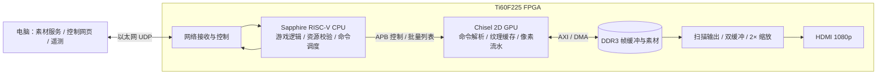

# AetherGX · FPGA 二维图形加速平台

AetherGX 在易灵思 Ti60F225 FPGA 上构建 RISC-V CPU 与自研二维 GPU 协同系统，完成游戏逻辑、批量图形命令、DDR3 图像搬运和 HDMI 显示。电脑通过以太网提供素材、控制和可视化网页；游戏逻辑与渲染执行在板端。

## 最新演示与性能

2026-10-30 演示版 CPU/GPU 时钟为 **125 MHz**，DDR3 时钟为 **500 MHz**，渲染分辨率为 **960×540 RGB565**，经 HDMI 输出约 60 Hz 的 1080p 图像。[BIT、固件与实测记录](release/overclock-125-20261030/)配套使用。

| 实板性能挑战 | 结果 |
|---|---:|
| 每帧动态精灵 | 3640 个 |
| 额外 Alpha 光晕 | 455 个 |
| 帧率 | 60.10 FPS |
| 验证帧数 | 3600 帧 |
| 超预算、迟到、新增显示下溢、GPU 错误 | 均为 0 |

3640 是当前测试程序的容量上限，不代表芯片的绝对极限。125 MHz 超频版静态时序核心 setup WNS 为 **−0.811 ns**，DDR 接收时钟域为 **−0.047 ns**；上述结果为一次板级测试，不能代表全部条件下稳定运行。原 100 MHz 版本保留在 [release/final-20261027](release/final-20261027/)。

## 系统架构



- **CPU 与软件**：板端运行游戏、碰撞与输入逻辑，加载并校验素材，组织 FrameList，管理显示和遥测。
- **GPU**：实现 Fill、Copy、Color Key、Alpha 混合等操作，结合纹理缓存、批量命令、预取和流水交接减少逐对象调度与访存开销。
- **存储与显示**：DDR3 保存素材和双帧缓冲；DMA 和共享仲裁连接 CPU、GPU 与显示扫描，HDMI 输出经两倍缩放。
- **网络与网页**：资源通过 UDP 传入，网页提供游戏操作、性能挑战与实时状态展示。网页指标区分实时遥测与历史专项结果。

## 研发历程

1. 搭建基于官方 Sapphire SoC、DDR3 和 HDMI 的板级基础，建立 CPU 绘制与 GPU 图形命令链路。
2. 完成颜色键、Alpha、纹理缓存与 DMA，接入真实素材和弹幕游戏，形成 CPU/GPU 对照。
3. 引入 FrameList 批量提交、CopyAhead、预取与写流水，降低命令和访存开销，扩展游戏档位与性能挑战。
4. 接入网页控制、网络遥测及 CPU/GPU 同屏展示，完善实板验证与可视化交互。
5. 在保留 100 MHz 版本的基础上测试超频，形成 125 MHz 实板演示版。

## 项目特点

- **软硬件协同**：CPU 负责场景与调度，GPU 在硬件侧执行批量二维绘制，游戏与显示运行于同一 FPGA。
- **面向场景的图形流水**：FrameList、纹理缓存、DMA 与预取组合，减少重复命令和访存等待。
- **可交互、可观测**：开发板按键、浏览器控制、实时遥测和自动性能挑战组成完整展示链路。
- **同屏对比**：CPU 与 GPU 分别更新 480×270 场景，用实际显示帧数展示协作运行效果；结果受显示刷新和 CPU 同时调度 GPU 的工作影响。

## 使用

板卡 IP `192.168.1.3`，电脑直连网卡 `192.168.1.2`。资源服务 UDP `8080`，控制 UDP `8090`，本机网页 HTTP `8765`。加载 BIT 和 BIN 使用 JTAG / RAM，不写 Flash。

```powershell
powershell -File scripts/run-bullet-asset-server.ps1 -Manifest sw/efinix_gpu/assets/interactive/manifest.csv -PcAddress 192.168.1.2
powershell -File scripts/run-control-gateway.ps1 -BoardIp 192.168.1.3 -UdpBind 192.168.1.2
```

打开 [本机网页](http://127.0.0.1:8765/#game)。更多操作见[网页控制](docs/efinix_2d_gpu/v3_control_usage.md)与[游戏说明](docs/efinix_2d_gpu/v3_game_usage.md)。125 MHz 的时钟配置和约束随交付文件保存；工程依赖 Efinity、官方 Sapphire BSP 与生成的 GPU RTL，单靠交付目录不能直接重建位流。

## 目录

| 路径 | 内容 |
|---|---|
| `chisel/src/main/scala/gpu/` | GPU 硬件设计 |
| `board/efinix_ti60/` | 板级集成、外设与约束 |
| `sw/efinix_gpu/` | 驱动、游戏、网络与网页 |
| `scripts/` | 构建、运行和验证脚本 |
| `release/` | 板级演示文件及校验值 |

开发历史和被精简的阶段报告可从 Git 历史查看。
